# Screenshots

[Back to README](../README.md) · [Detailed feature coverage](user-guide.md)

These are captures of APKForge's actual Qt interface, rendered with the Fusion
style at 1200 × 1000 for the main window and 900 × 720 for settings. They use
empty inputs and temporary settings, with tool
installation and probing disabled. No APK processing, signing results or device
connections are staged. Fonts and window decorations may differ on your desktop.

## Main

The everyday shortcuts: decode, compile, align, sign and merge. Open the project manifest, Apktool configuration or launcher activity from the same screen.

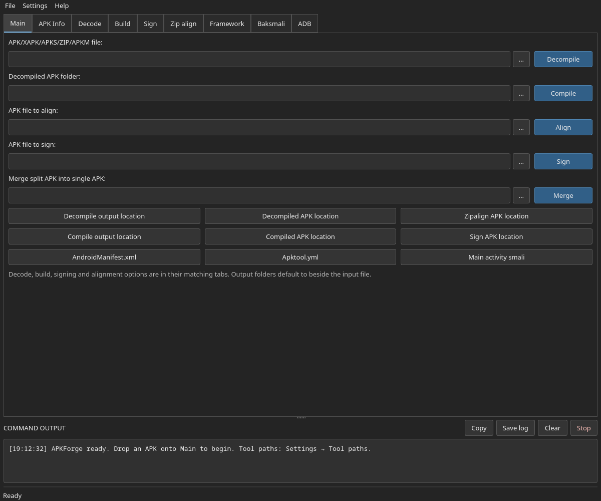

## APK Info

Read package details, SDKs, permissions and locales; inspect AAPT output, verify signatures, and preview/export bitmap icons. Fields are empty here because no APK has been loaded.

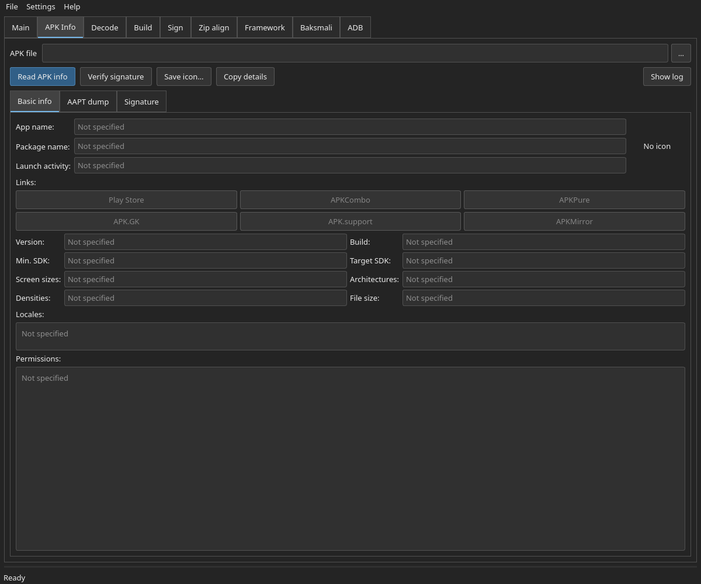

## Decode

Choose Apktool or APKEditor, control source/resource decoding, set frameworks and threads, and preview the command before starting.

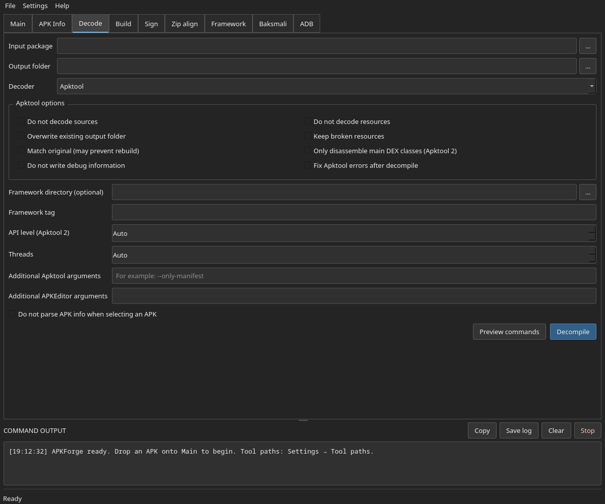

## Build

Rebuild a decoded project with custom AAPT, framework and resource options. Alignment and signing can follow a successful build.

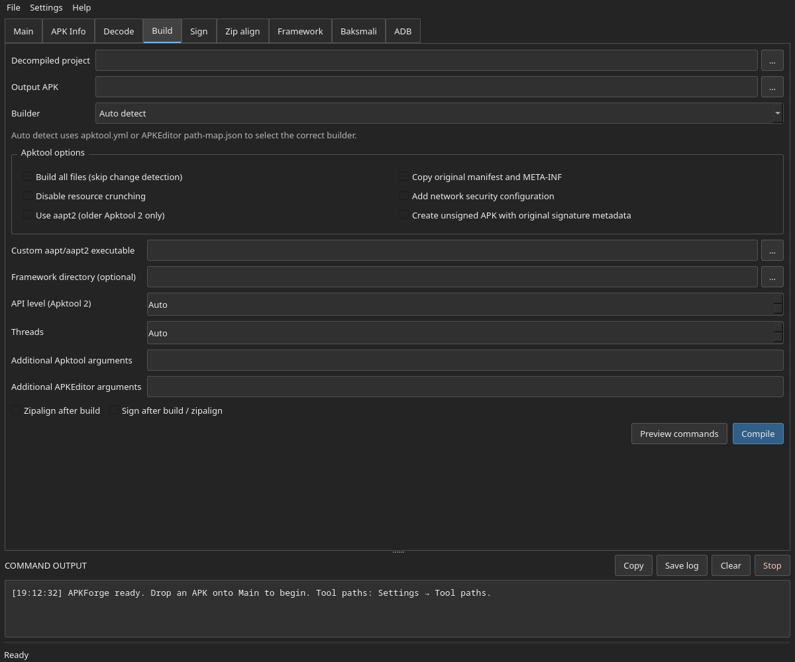

## Sign

Use the development identity, a keystore, or a private key and certificate. Configure signature schemes and verify the result.

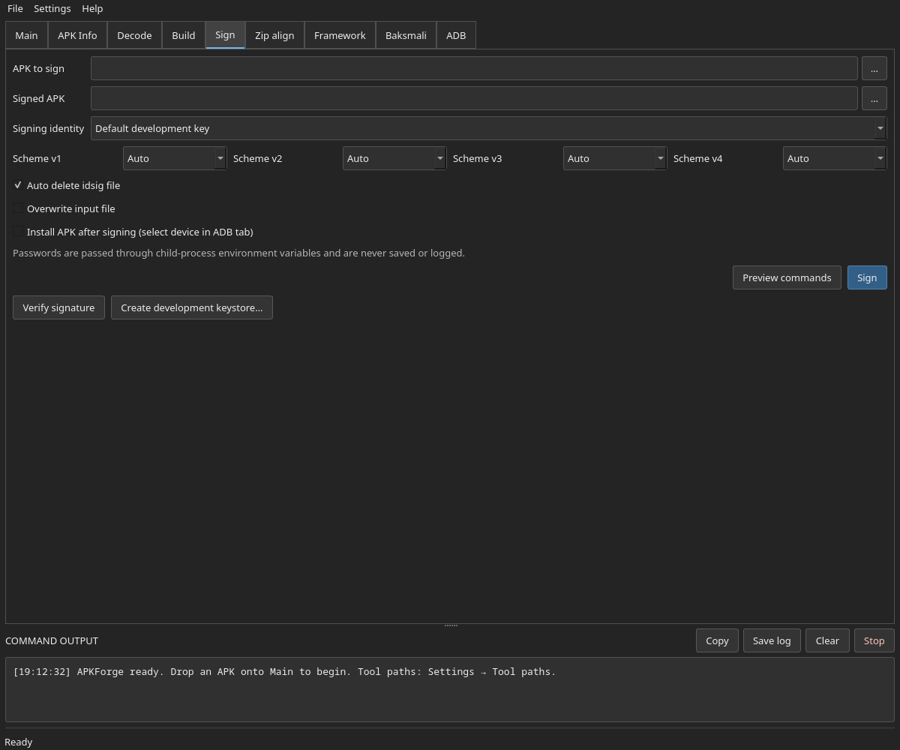

## Zip align

Check or apply alignment, select native-library alignment, and optionally sign the aligned APK. Split-package merge controls are also available.

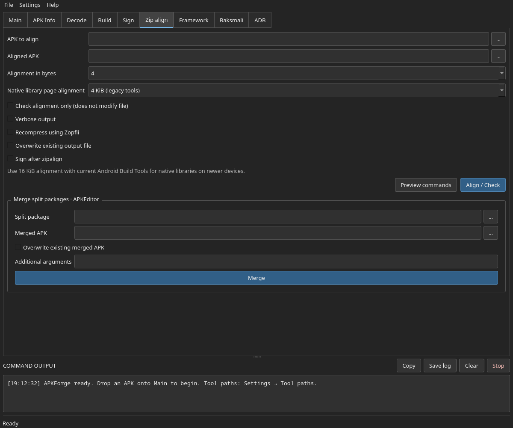

## Framework

Install and tag framework APKs, select a cache, or clean the app-managed framework directory.

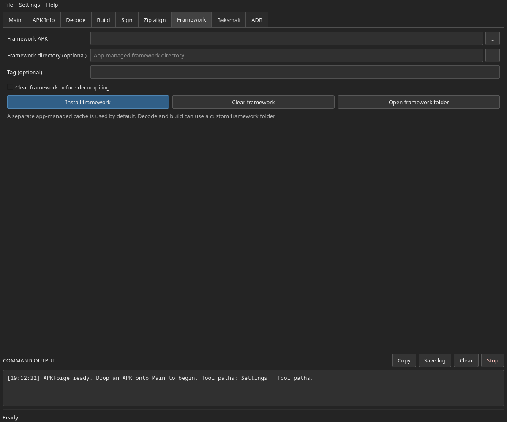

## Baksmali

Disassemble supported inputs to smali or assemble a smali folder into DEX, with API, thread and additional argument controls.

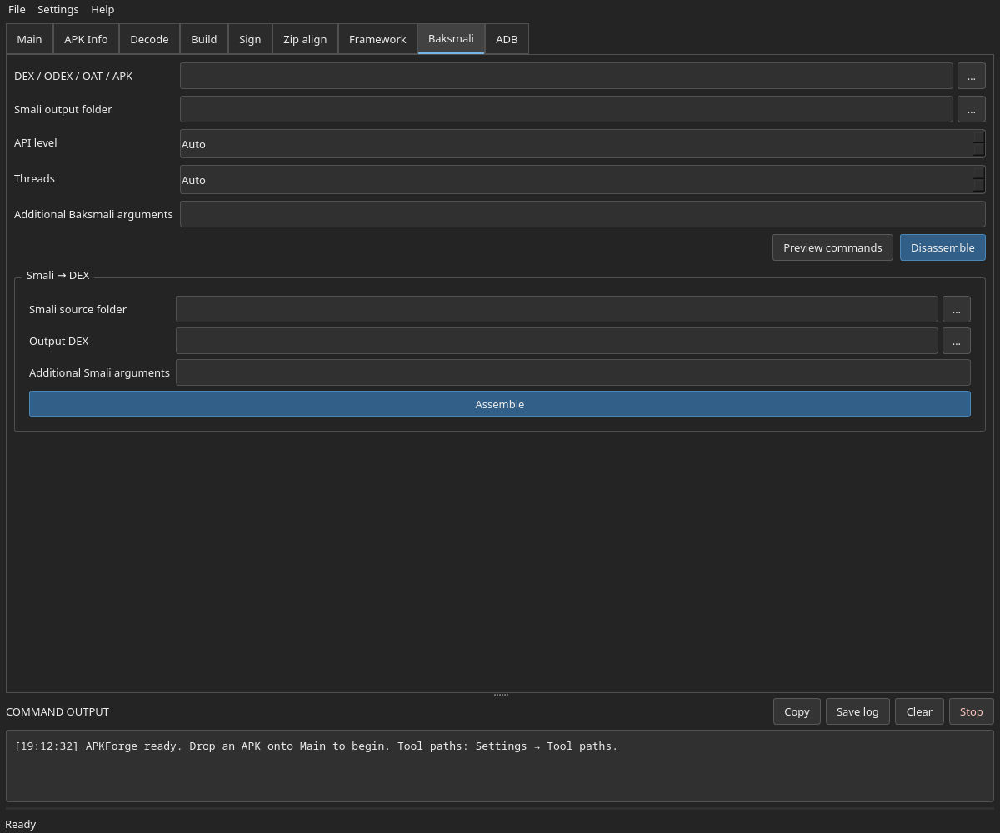

## ADB

Refresh connected devices, select an authorized target and install an APK. No device is connected in this capture.

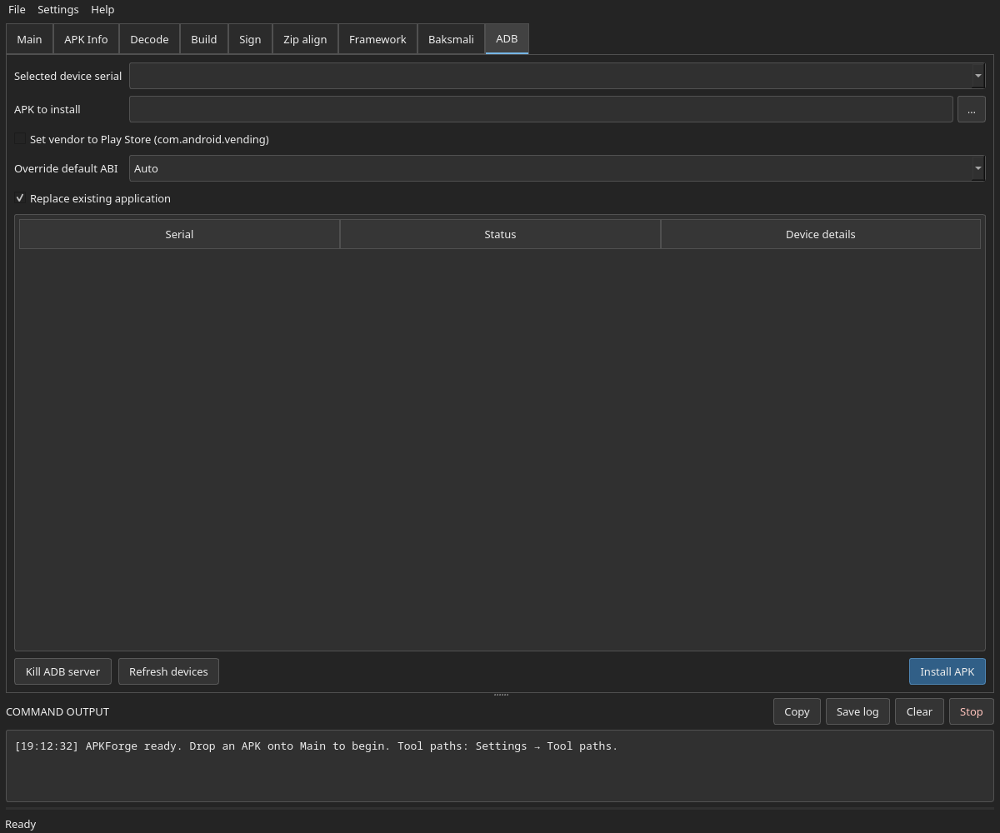

## Tool paths

Point to existing executables or JARs and choose where future managed tool downloads are installed.

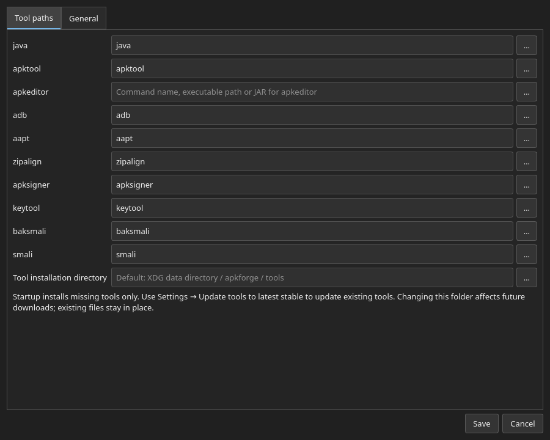

## General settings

Set theme, interface language, Java VM arguments, temporary storage and completion preferences.

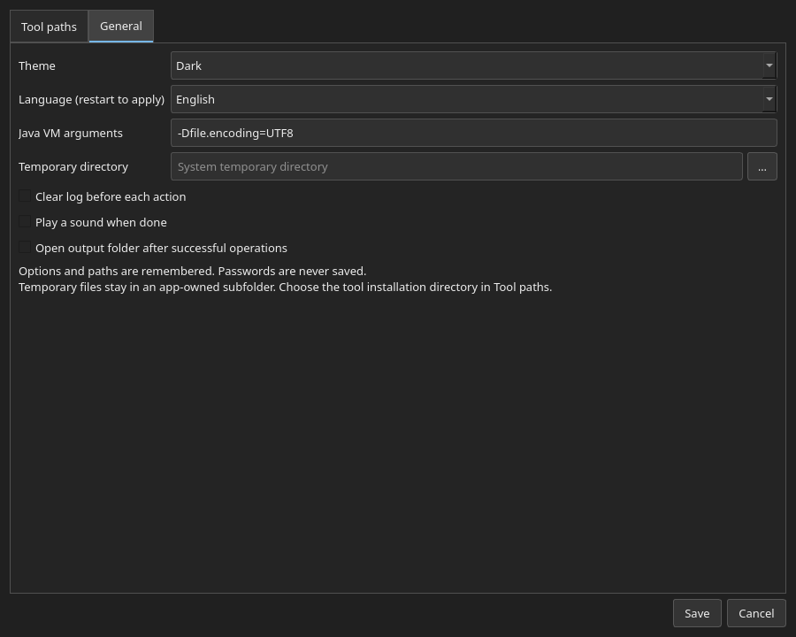

## Light theme

The same Main screen with the light theme selected. A system theme option is also available.

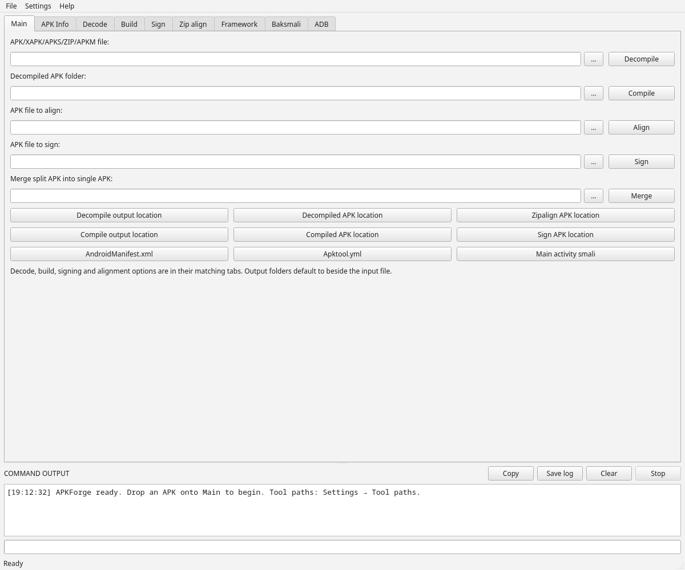

## Updating the screenshots

From the project root with PySide6 installed:

```bash
QT_QPA_PLATFORM=offscreen QT_QPA_PLATFORMTHEME= python scripts/screenshots.py
```

The script writes the twelve PNGs in `docs/screenshots/`, isolates settings in a
temporary directory and never launches external tools. Clearing the desktop's
platform theme avoids loading KDE integration during headless capture. Review the
images after UI changes and keep the README and feature descriptions in sync.
